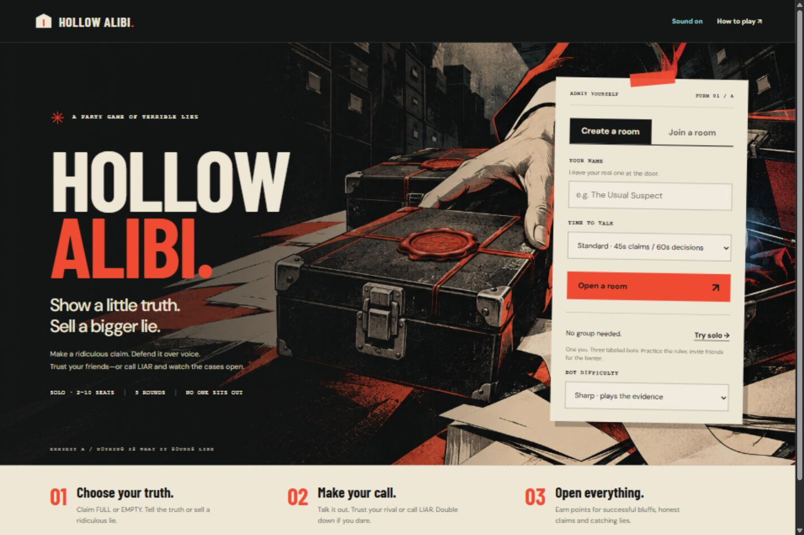
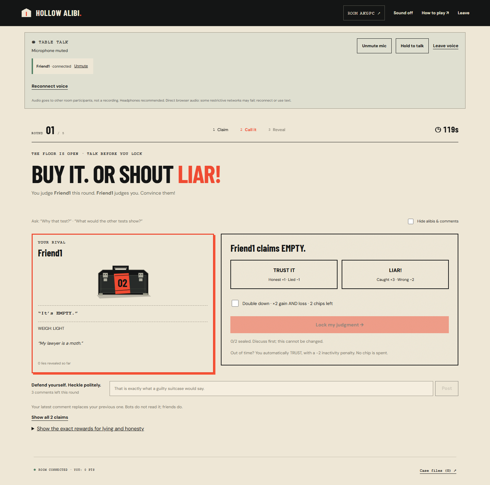
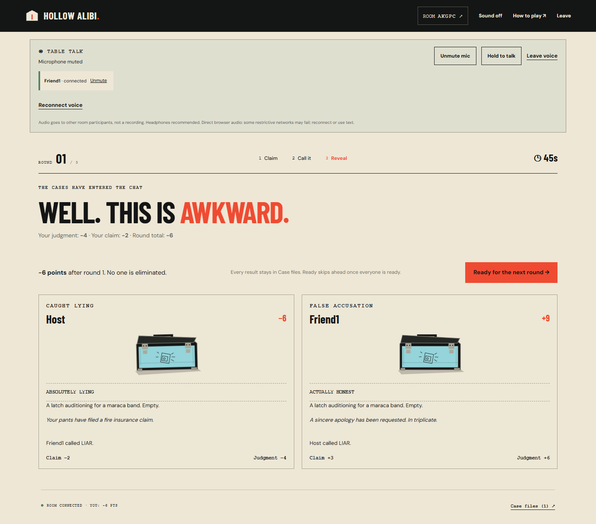
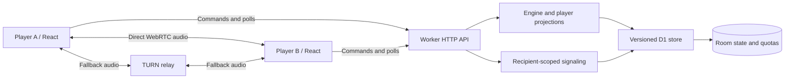

# Hollow Alibi

**Show a little truth. Sell a bigger lie.**

[](https://github.com/rmaytr/Hollow-Alibi/actions/workflows/ci.yml)


[**Play live →**](https://hollow-alibi.smoky-harp-3438.chatgpt.site/) · [Local setup](docs/development.md) · [Architecture](docs/architecture.md) · [Testing](docs/testing.md)



A browser party game of selective evidence for **2–10 players**, or one person practicing with bots. Your case is secretly full or empty. Make a claim, publish one real clue, defend your story over voice, then trust your assigned rival—or call **LIAR**. Five rounds, explicit stakes, and no elimination.

Create a room and share its five-letter code. Each player uses their own phone or computer. No game account, installation, or shared display is required.

## See the game

| Make your call | Open the cases |
| --- | --- |
|  |  |
| Judge one named opponent using a genuine clue that may support a dishonest claim. | See what was inside, who fooled whom, and how every point was awarded. |

These are real application screenshots. The homepage comes from the deployed game; gameplay images come from isolated local browser tests.

## Features

- **Honesty and deception both matter.** Selling a lie earns +3; honest claims earn +2 when trusted or +3 when falsely accused. A caught lie costs 2. Judges have separate rewards and penalties.
- **Two chips, meaningful risk.** Double down to double your judgment's gain or loss, without changing the opponent's claim payout.
- **One social loop for small and large rooms.** Everyone gets one rival and one judge. Independent dealing prevents your own case revealing someone else's answer.
- **Solo and mixed rooms.** Up to nine labeled bots with Casual, Sharp, Expert, or Mixed difficulty. Bots use evidence and revealed history, not speech or written defenses.
- **Built-in table talk.** Opt-in WebRTC voice, muted entry, hold-to-talk, individual mute, reconnect, and text comments. The live deployment has TURN fallback.
- **Twenty shuffled comic premises.** Terrible excuses, absurd contents, outcome-specific reveals, and a five-round case-file recap.
- **Recoverable sessions.** Refresh restores your seat; an absent host can be replaced. Missed judgments default to TRUST with a separate −2 inactivity penalty.
- **Responsive UI.** Rival-first decisions, named dialogs, visible focus, reduced-motion support, optional sound, and adjustable pace.

## Technology and architecture

| Layer | Implementation |
| --- | --- |
| UI / contracts | TypeScript 5.9, React 19, TSX, custom CSS and SVG |
| Framework / build | Next.js App Router-compatible APIs through Vinext 1.0 beta; Vite 8 |
| Server | Cloudflare Workers, six JSON HTTP route handlers |
| Storage | Cloudflare D1 / SQLite, Drizzle schema/migrations, prepared SQL at runtime |
| Synchronization | Authoritative state machine, HTTP commands, adaptive polling, versioned snapshots |
| Concurrency | Optimistic compare-and-swap, bounded retries, command deduplication |
| Voice | WebRTC, SDP/ICE, STUN; Metered TURN on the live deployment |
| Tests | Node native test runner, real SQLite adapter, Playwright |
| Publication | GitHub source and CI; existing OpenAI Sites / Cloudflare deployment |



Game state uses polling, approximately every 1.2 seconds in visible tabs and 5 seconds in background tabs. Audio uses real-time WebRTC. The server owns dealing, validation, deadlines, scoring, and transitions. Each browser receives a player-safe projection; audio is not recorded by the app. [Architecture details →](docs/architecture.md)

## Run locally

Requires **Node.js 24+**, npm, and Git. `.nvmrc` selects 24.

```sh
git clone https://github.com/rmaytr/Hollow-Alibi.git
cd Hollow-Alibi
npm ci
npm run build
npm run db:setup
npm run dev -- --hostname 127.0.0.1 --port 5183
```

Open **http://127.0.0.1:5183**. Run `db:setup` **once per fresh local database**; it executes the initial SQL migration. Do not replay it on a populated database. Local data stays in ignored `.wrangler/state`, separate from production.

These development instructions are for the owner and anyone with separate permission; they do not grant a [reuse license](LICENSE).

No production credentials are needed for local gameplay or CI. Optional local TURN setup is in [.env.example](.env.example) and [development.md](docs/development.md). Microphones need localhost or HTTPS and browser permission.

```sh
npm test                  # engine, compatibility, SQLite and voice-state tests
npm run typecheck
npm run docs:check
npm run build
npx playwright install chromium
```

With the local server running, use `npm run test:api` and `npm run test:smoke`. The longer voice/full-match suite is `npm run test:browser`. [Setup and troubleshooting →](docs/development.md)

## Verification

| Evidence | Scope |
| --- | --- |
| **54 automated tests** | Payoffs, concurrency, hidden information, lifecycle, bots, compatibility, voice authorization and cleanup |
| **10 browser clients / 90 directed audio paths** | Inbound RTP, mute and interruption recovery on one machine with synthetic microphones |
| **Forced TURN verification** | Two hosted clients, relay-only ICE, both directions, mute and reconnect checks |
| **23-second signaling outage** | Automatic recovery of an expired voice lease |
| **Full browser matches** | Five-round duel and solo, refresh, recap, rematch; solo at a 320px viewport |
| **Human testing** | Owner-reported successful play and voice with other people; no formal participant count or satisfaction metric |

The **CI badge shows GitHub's actual status**. The workflow installs the lockfile, runs tests/typechecking/documentation checks, builds, initializes a fresh local database, and runs API plus two-player browser smoke checks. Optional voice tests stay separate because they depend on browser media and network traversal. [Methodology and evidence →](docs/testing.md)

## Source map

```text
app/                    Page, metadata, CSS and HTTP routes
components/             Entry/lobby/game screens, dialogs, SVG art, voice UI
hooks/use-hollow-room.ts Synchronization, restoration and retries
lib/game-engine.ts      Rules, assignments, scoring and lifecycle
lib/game-store.ts       D1 persistence, CAS, quotas and cleanup
lib/game-server.ts      Sessions, authorization and HTTP handling
lib/showdown.ts         Scenarios, payoffs and public-information bots
lib/voice-*.ts          Signaling state and safe ICE configuration
db/ and drizzle/        Schema and migration
tests/                  Engine, SQLite, API, smoke and voice tests
docs/                   Architecture, setup, testing, case study, assets
build/ and scripts/     Retained Sites adapters and development tooling
```

## Project context

Built with **OpenAI Codex assistance**. The owner directed the concept, visual style and priorities; evaluated playable iterations; requested the gameplay redesign; and performed human testing. AI tools assisted research, implementation, verification and review. In-game bots are rule-based/probabilistic policies, not language-model agents.

Key challenges included private-information boundaries, concurrent actions, retry-safe scoring, and media lifecycles. Review resolved a timeout payout-denial exploit, wasted chips, reconnect mute loss, erased comment drafts, and quota cleanup lag. [Technical case study →](docs/case-study.md)

## Limits and roadmap

- Private rooms only; no public stranger matchmaking.
- Polling fits phase-based play; this is not action-game networking.
- Mesh voice is bounded to ten seats; bandwidth grows with peer count. No many-room capacity or geographic load claim is made.
- TURN depends on provider quota and valid scoped ICE credentials. Management keys must remain server-side.
- Expert optimizes estimated value; no comparative tournament proves superiority against every strategy.
- Priorities: physical-device/Safari/Firefox checks, relay credential rotation and usage controls, a measured bot benchmark, broader accessibility testing, and more scenario variety.

## Attribution and license

Original visuals combine SVG and AI-generated key art; self-hosted font licenses and vendored notices are retained. See [asset provenance](docs/assets.md) and [third-party notices](THIRD_PARTY_NOTICES.md).

**Proprietary — all rights reserved.** Original project materials are published for portfolio review, with no general reuse, redistribution, or derivative-work license granted. Playing the officially hosted game remains permitted. Third-party materials retain their own terms. See [LICENSE](LICENSE) and [license details](LICENSE-STATUS.md), including GitHub's public-repository viewing and forking terms.

GitHub publication does not automatically redeploy the game. The hosting checkout, live Site identity, and other games remain separate.
