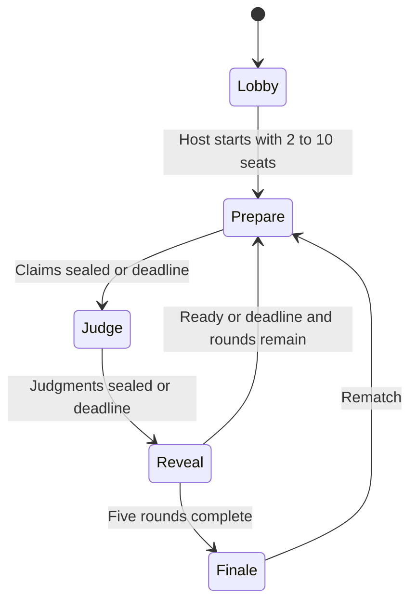

# Architecture

## Boundaries

React renders `RoomView`; browsers send intentions, not scores or secret outcomes. The Workers HTTP layer authenticates a guest session, validates input/origin, authorizes membership, and dispatches to the engine/store. `RoomState` remains server-only. `projectRoom` deliberately excludes private RNG state, session hashes, other unsealed decisions and persistence receipts. Bots use the same restricted view.

| Module | Responsibility |
| --- | --- |
| `components/hollow-game.tsx` | Homepage, entry, lobby, settings, shared navigation, finale |
| `components/showdown-game.tsx` | Claims, clues, judgments, comments, reveals |
| `components/hollow-dialog.tsx` | Named native dialogs, rules, recap |
| `components/hollow-art.tsx` | Reusable original SVG |
| `hooks/use-hollow-room.ts` | Requests, polling, versions, saved seat, retries |
| `lib/game-types.ts` | Shared contracts and server persistence types |
| `lib/game-engine.ts` | Authoritative transitions, validation, dealing, scoring |
| `lib/showdown.ts` | Payoffs, twenty scenarios, permitted-information bot policies |
| `lib/game-store.ts` | Prepared SQL, CAS, quotas, cleanup |
| `lib/game-server.ts` | Sessions, origin/member checks, bounded JSON, responses |
| `components/room-voice.tsx` | Media acquisition, connections, controls, recovery |
| `lib/voice-state.ts` | Membership/epoch-scoped SDP and expiry |
| `lib/voice-config.ts` | Validated STUN/TURN configuration |

## State machine

HTTP entry points:

| Method and path | Purpose |
| --- | --- |
| `POST /api/session` | Establish anonymous guest cookie |
| `POST /api/rooms` | Create a room |
| `POST /api/rooms/join` | Join by code |
| `GET /api/rooms/:code` | Authorized player-specific state/presence |
| `POST /api/rooms/:code/action` | Validated game command |
| `POST /api/rooms/:code/voice` | Voice join/leave/poll and scoped SDP |

Requests advance overdue phases before applying actions; there is no per-room background timer. Reveal deadlines start at actual resolution. Preparation/judgment lasts 45/60 seconds standard or 90/120 relaxed. Showdown reveals start at 30/45 seconds plus two seconds per seat beyond two; all-ready can advance after a minimum interval.

Independent dealing preserves uncertainty in duels. A shuffled non-self ring assigns exactly one judge per claimant. Missing claims pay nobody. Missing judgments become TRUST without a double, plus a separate −2 inactivity penalty, preserving valid claimant payouts. Original-rule snapshots remain compatible until start/rematch upgrades them.

## Persistence and concurrency

`game_rooms` stores a JSON aggregate, instance, version and expiry. Conditional UPDATE compares code, instance and version; conflicts reload/retry up to twelve attempts. Scores, phase and command receipt commit together. Actions carry request ID and instance/match/round/phase. A bounded 256-command ledger recognizes identical retries and rejects changed reuse; this is not indefinite exactly-once delivery.

`game_limits` stores atomic per-window counters. Both tables have expiry indexes. Bounded expired-room cleanup runs on creation; new quota buckets also clean expired quota rows. Expiry is enforced before physical deletion. Rooms last twelve hours; cookies seven days.

## Synchronization and security

Visible tabs poll around 1.2 seconds; hidden tabs around five. Version/generation checks reject stale snapshots or obsolete connections. Server timestamps adjust the countdown. Local storage retains a room reference; an HTTP-only cookie identifies the guest.

Guest tokens use 32 random bytes, hashed before room identity storage. Cookies are SameSite=Lax and Secure over HTTPS. Writes require same-origin bounded JSON, permitted fields, authorized actors and the correct phase. Prepared SQL and non-cacheable responses are used; errors do not echo private state. Secret HMAC-SHA-256 dealing uses a persisted counter; public IDs use a separate serial.

## Voice

Authenticated HTTP carries offers/answers. Ordered player IDs select one offerer per pair. WebRTC carries audio directly or through TURN; D1 stores short-lived signaling only. At ten clients the mesh has 45 peer connections / 90 directed audio paths.

Peer leases/signals expire around twenty seconds. Signals target a player and epoch so replacement connections reject stale messages. SDP is bounded to 12,000 characters and audio-only. Normal room views exclude signaling. Expired leases rejoin with a new epoch; replacement audio elements inherit individual mute settings.

## Tradeoffs

The aggregate/CAS model simplifies atomic outcomes but writes a full room record and may contend under media signaling. Polling fits a social game; mesh upload demand grows with peers. Larger rooms or high throughput need measured architectural changes, not merely a higher seat cap.
